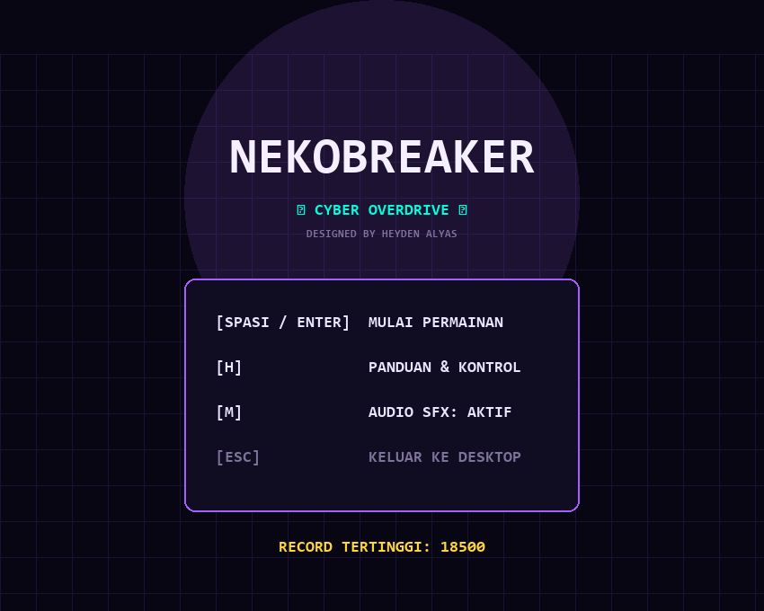
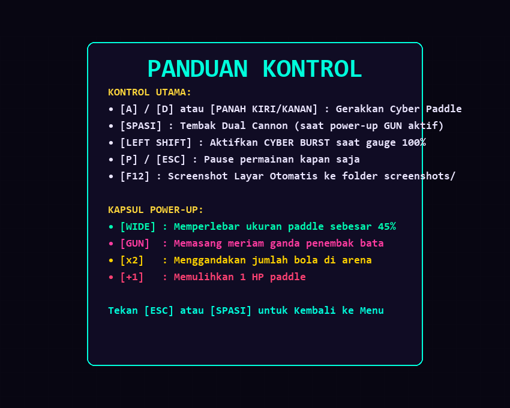
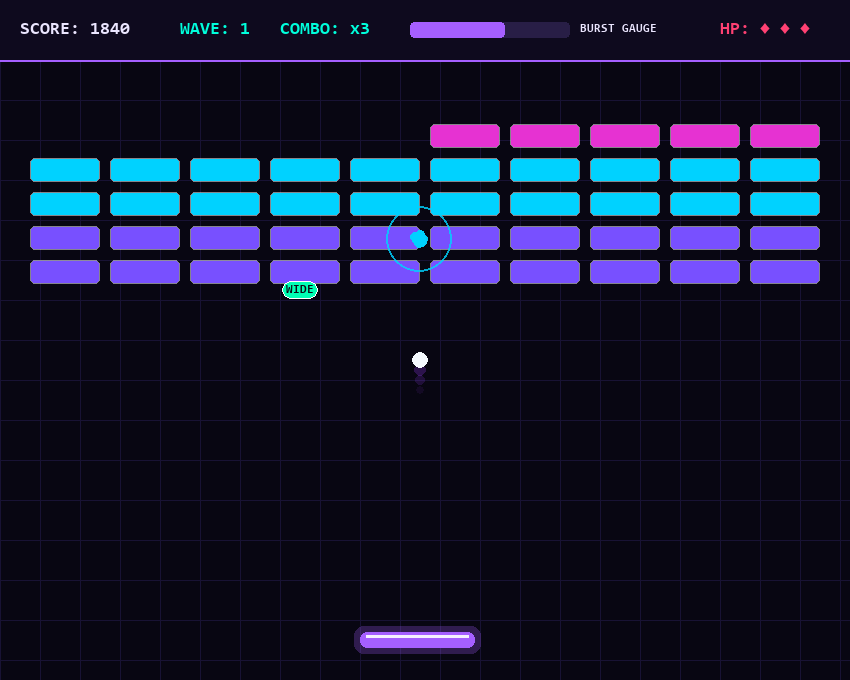
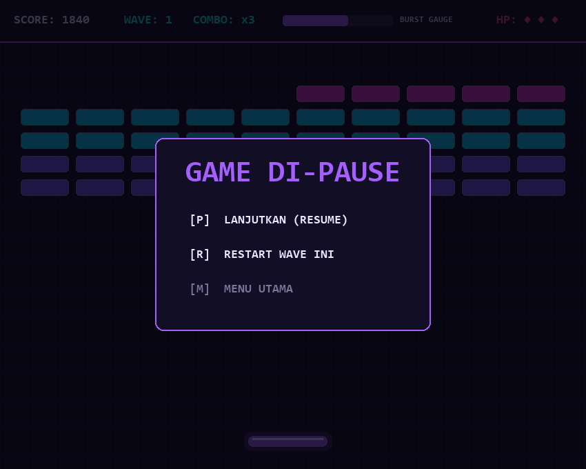
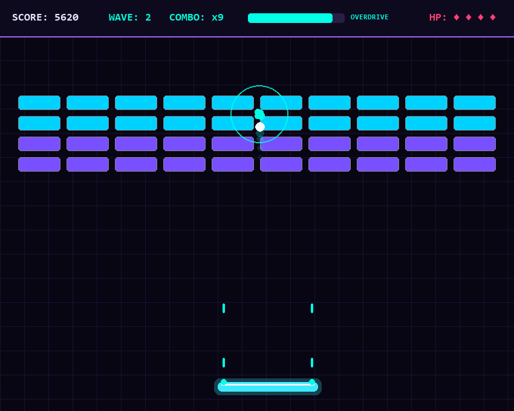
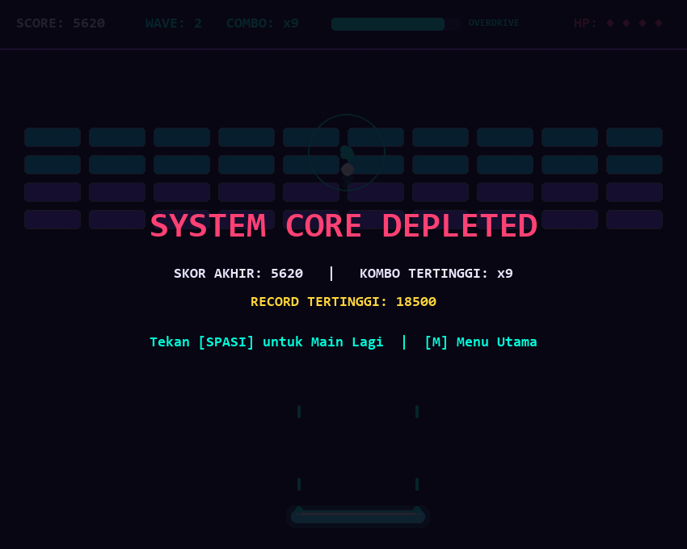

# ⚡ NekoBreaker: Cyber Overdrive

Game arcade modern Brick Breaker bertema **Cyberpunk Neon & Holographic Void** yang dikembangkan dengan arsitektur **Object-Oriented Programming (OOP)** penuh dalam **1 file Python tunggal (`brickbreaker.py`)**. 

Dibuat & Disesuaikan oleh: **Heyden Alyas**

---

## 📸 Tangkapan Layar Game (`screenshots/`)

Folder khusus [`screenshots/`](screenshots/) menyimpan tangkapan layar lengkap setiap fase dan mode permainan:

| 01. Menu Utama | 02. Panduan Kontrol & Info | 03. Gameplay Cyber Matrix |
| :---: | :---: | :---: |
|  |  |  |

| 04. Menu Pause Interaktif | 05. Dual Cannon & Overdrive | 06. Game Over Screen |
| :---: | :---: | :---: |
|  |  |  |

> 💡 **Fitur Tangkapan Layar In-Game**: Pemain dapat menekan tombol **`F12`** kapan saja di dalam game untuk menyimpan screenshot resolusi penuh secara otomatis ke folder `screenshots/`.

---

## 📂 Struktur Direktori Proyek

```text
9 Game BrickBreaker/
├── screenshots/                               # Folder khusus tangkapan layar game
│   ├── 01_menu_utama.png
│   ├── 02_panduan_kontrol.png
│   ├── 03_gameplay_cyber_matrix.png
│   ├── 04_mode_pause.png
│   ├── 05_cyber_overdrive_laser.png
│   ├── 06_game_over.png
│   └── 07_stage_victory.png
├── assets/                                    # Aset gambar dokumentasi
│   ├── menu.png
│   ├── gameplay.png
│   └── pause.png
├── .gitignore
├── brickbreaker.py                            # 1 file Python mandiri (Game, OOP, Menu, SFX)
└── README.md                                  # Dokumentasi lengkap edisi Heyden Alyas
```

---

## 🌟 Fitur Unggulan

1. **Arsitektur Mandiri 1 File (`brickbreaker.py`)**:
   - Seluruh logika, grafis, partikel, audio synthesizer, dan sistem status terintegrasi dalam satu file tanpa dependensi aset eksternal.
2. **Menu Utama & Panduan Kontrol Interaktif**:
   - Menu utama dinamis dengan efek animasi teks berdenyut (*pulse glow*).
   - Layar panduan kontrol & informasi fungsi power-up (`[H]`).
   - Sistem penyimpanan dan pelacakan rekor nilai (*High Score*).
3. **Menu Pause Interaktif**:
   - Tekan `[P]` atau `[ESC]` kapan saja saat bermain untuk menjeda game.
   - Pilihan melanjutkan (*Resume*), restart wave saat ini, atau kembali ke menu utama.
4. **Sistem Prosedural Sound FX (8-Bit Retro Sci-Fi)**:
   - Efek suara sintetis langsung dihasilkan oleh modul Python `wave` dan `io` tanpa memerlukan file `.wav`/`.mp3` eksternal.
   - Suara pantulan paddle, benturan bata, tembakan laser, perolehan power-up, dan aktivasi Overdrive.
   - Dapat di-*mute* kapan saja dengan tombol `[M]`.
5. **Mode Cyber Burst / Overdrive (`LEFT SHIFT`)**:
   - Benturan bola mengisi indikator energi *Burst Gauge*. Saat mencapai 100%, pemain dapat mengaktifkan Overdrive selama 6 detik di mana bola berubah menjadi plasma penembus matrix tanpa memantul balik (*piercing damage*).
6. **Kapsul Power-Up Jatuh**:
   - `WIDE`: Memperlebar paddle sebesar 45%.
   - `GUN`: Memasang sepasang meriam laser pada paddle (tekan `SPASI` untuk menembak).
   - `x2`: Menggandakan bola di arena (*Multi-Ball*).
   - `+1`: Menambah 1 HP nyawa paddle.
7. **Sistem Wave Berkelanjutan**:
   - Membersihkan seluruh matrix bata akan membuka wave berikutnya dengan kecepatan bola yang semakin menantang.
8. **Efek Visual Spektakuler**:
   - *Screen Shake* halus saat benturan besar.
   - Cincin gelombang kejut (*Shockwave*) saat bata hancur.
   - Jejak ekor neon (*Light Trail*) pada pergerakan bola.

---

## 🎮 Kontrol Permainan

| Tombol | Fungsi |
| :--- | :--- |
| **`A` / `D`** atau **`Panah Kiri` / `Kanan`** | Menggerakkan Cyber Paddle |
| **`SPASI`** | Menembakkan Laser (jika power-up `GUN` aktif) / Melanjutkan Game |
| **`LEFT SHIFT`** | Mengaktifkan **Cyber Overdrive** (saat Gauge 100%) |
| **`P` / `ESC`** | Membuka Menu Pause |
| **`M`** | Mengaktifkan / Menonaktifkan Audio SFX |
| **`H`** | Melihat Panduan & Kontrol di Menu Utama |
| **`F12`** | Mengambil Tangkapan Layar (Screenshot) Otomatis ke `screenshots/` |

---

## 🚀 Cara Menjalankan

Cukup jalankan file ini menggunakan Python:

```powershell
python brickbreaker.py
```
atau jika menggunakan virtual environment:
```powershell
.\.venv\Scripts\python.exe brickbreaker.py
```
